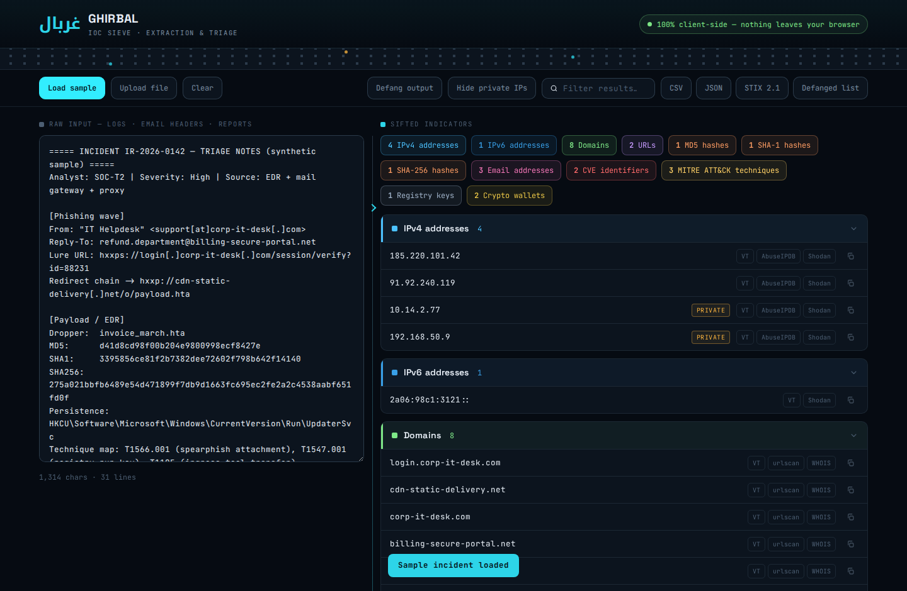
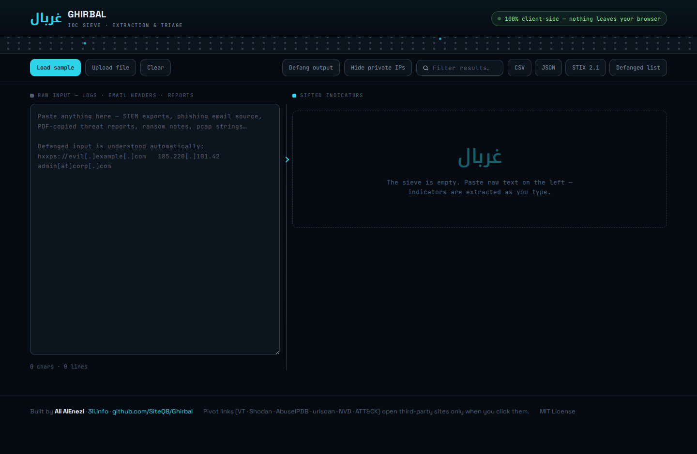
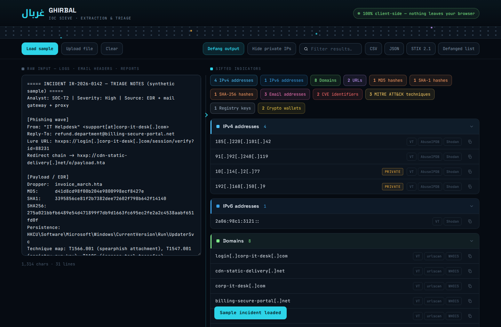

# Ghirbal · غربال

**A 100% client-side IOC extraction & triage sieve for SOC, DFIR and CTI analysts.**

*Ghirbal* (غربال) is Arabic for **sieve** — paste raw noise (SIEM exports, phishing email source, threat reports, ransom notes, pcap strings) and it sifts out clean, classified, deduplicated indicators of compromise. Nothing you paste ever leaves your browser.

🔗 **Live tool:** https://siteq8.github.io/Ghirbal/

## Why Ghirbal

Every analyst has done this the painful way: manually picking IPs and hashes out of a 40-page vendor PDF, un-defanging them one by one, then re-defanging them for the report. Ghirbal does the whole loop in one paste:

- **Defang-aware ingestion** — `hxxps://evil[.]example[.]com`, `185.220[.]101.42`, `admin[at]corp[.]com` are all understood automatically.
- **12 indicator types** — IPv4, IPv6, domains, URLs, MD5 / SHA-1 / SHA-256, emails, CVE IDs, MITRE ATT&CK technique IDs, Windows registry keys, and crypto wallets (BTC legacy + bech32).
- **Noise controls** — private / loopback / link-local / CG-NAT / multicast IPs are auto-tagged and can be hidden with one click; common file extensions are excluded from domain matching.
- **Enrichment pivots** — one click to VirusTotal, AbuseIPDB, Shodan, urlscan, MalwareBazaar, WHOIS, NVD, and attack.mitre.org (third-party sites open only when *you* click).
- **Safe-sharing mode** — a global **Defang output** toggle renders every indicator report-safe.
- **Four exports** — CSV (Excel-ready), JSON, plain defanged list, and a proper **STIX 2.1 bundle** (indicators with STIX patterns + `vulnerability` SDOs for CVEs) ready for your TIP/MISP pipeline.
- **Zero backend, zero telemetry, zero dependencies** — one static HTML file. Works from GitHub Pages, a USB stick, or an air-gapped analyst workstation.

## Screenshots

| Empty sieve | Defanged output mode |
|---|---|
|  |  |

## Usage

1. Open the [live tool](https://siteq8.github.io/Ghirbal/) — or clone and open `index.html` locally (fully offline-capable).
2. Paste anything into the left pane, or **Upload file** (`.txt`, `.log`, `.eml`, `.csv`, `.json`, …). Extraction runs live as you type.
3. Triage with the filters (**Hide private IPs**, search box), pivot to enrichment, then export.

Try **Load sample** for a synthetic incident (fake phishing wave + dropper + C2 + ransom note) that exercises every extractor.

## Privacy model

All parsing is done by JavaScript in your own browser tab. There are no analytics, no network calls at runtime, and no server. The only outbound traffic Ghirbal can ever cause is a pivot link that you explicitly click, which opens the indicator on a third-party enrichment site — so treat pivots on sensitive internal indicators accordingly.

## STIX 2.1 mapping

| Ghirbal type | STIX object |
|---|---|
| IPv4 / IPv6 | `indicator` — `[ipv4-addr:value = '…']` / `[ipv6-addr:value = '…']` |
| Domain / URL / Email | `indicator` — `domain-name` / `url` / `email-addr` patterns |
| MD5 / SHA-1 / SHA-256 | `indicator` — `[file:hashes.… = '…']` |
| Registry key | `indicator` — `[windows-registry-key:key = '…']` |
| CVE | `vulnerability` SDO with `cve` external reference |

## Limitations

Ghirbal is a regex-based triage sieve, not a validator: extracted domains/IPs are syntactic matches, and unusual formats (heavily obfuscated indicators, base64-wrapped payloads) may need a decode pass first. Always verify before blocking.

## Author

**Ali AlEnezi** — [3li.info](https://3li.info) · [@SiteQ8](https://github.com/SiteQ8)

Sister projects: [KWTWatch](https://github.com/SiteQ8) · [LLM-DFIR](https://siteq8.github.io/LLM-DFIR) · [NCA-ECC-Crosswalk](https://siteq8.github.io/NCA-ECC-Crosswalk/)

MIT License
